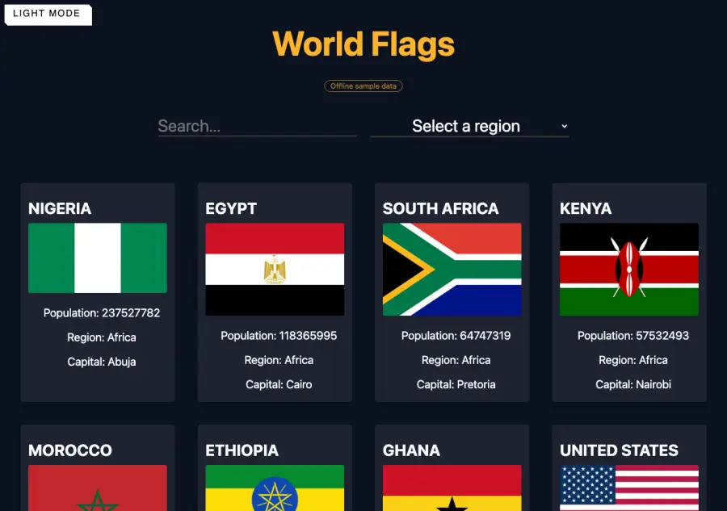

# World Flags

Browse the flags of every country, search them by name and filter them by region.

[](https://github.com/LaCobble/World_Flags/actions/workflows/ci.yml)


[](LICENSE)

## What it does

A vanilla HTML/CSS/JavaScript page that loads country data from the [REST Countries](https://restcountries.com/) API and shows a card per country (flag, name, population, region, capital):

- **Search** a country by name.
- **Filter** by region: Africa, Americas, Asia, Europe, Oceania.
- **Light / dark mode** toggle.

## Screenshot



<sub>Rendered locally in headless Chrome (October 2026), using the bundled sample data.</sub>

## Offline sample data

The app was written for the REST Countries **v3.1** API, which has since been retired; the current **v5** API requires an account and an API key, which a public static page cannot keep secret. When the API does not return a country list, the app now falls back to `sample-countries.js`: 40 countries across all five regions (populations from the World Bank, 2025 estimates; flags from [flagcdn.com](https://flagcdn.com/)) and shows a discreet **Offline sample data** badge. Search and the region filter keep working on that sample.

## Prerequisites

- A modern web browser with an internet connection (flag images are loaded from flagcdn.com).

## Getting started

```bash
git clone https://github.com/LaCobble/World_Flags.git
cd World_Flags
open index.html        # or double-click it / use `xdg-open` on Linux
```

There is no build step and no test suite; the CI checks the JavaScript syntax, that every local asset referenced by the HTML exists, and scans for secrets.

## Project structure

```
World_Flags/
├── index.html   # layout: search bar, region filter, card grid
├── script.js    # API calls (async/await + fetch) with offline fallback, card rendering, theme toggle
├── sample-countries.js  # bundled sample of 40 countries
└── index.css
```

## What it demonstrates

- Calling a public REST API with `fetch` and `async`/`await`.
- Building DOM elements dynamically from JSON.
- Theme switching with CSS classes.

## Context

Personal / school web project built in June 2023. Kept as a portfolio piece; no longer actively developed.

## Contributing

See [CONTRIBUTING.md](CONTRIBUTING.md) and the [Code of Conduct](CODE_OF_CONDUCT.md). Security issues: [SECURITY.md](SECURITY.md).

## License and credits

[MIT](LICENSE) © LaCobble. Country data from [REST Countries](https://restcountries.com/) and, for the offline sample, the [World Bank](https://data.worldbank.org/indicator/SP.POP.TOTL); flags from [flagcdn.com](https://flagcdn.com/); favicon globe from Vecteezy.
